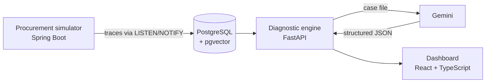

# Cause.Bug.MLOps

**Automated root cause analysis for a procurement workflow.** I inject a fault into a
purchase-approval simulator, and a RAG pipeline (PostgreSQL + pgvector + Gemini) reads the
execution traces and the business rules, then explains what broke, where, and why — with
the evidence it relied on.

**[▶ Live demo](https://mohamed5mehdi.github.io/cause-bug-mlops/)** — runs in the browser, nothing to install (replays recorded diagnostics; no live model calls).

## Why I built this

During my final-year engineering project I worked on procurement software: purchase
requests going through a chain of approvals, budget envelopes, purchase orders. Two bugs
from that time stayed with me: one in the VAT calculation, one in the purchase approval
process.

Both times, the hard part was not fixing the code. It was going through logs and database
rows to find *where* the problem started. I wanted to know whether a language model, given
the right context, could do that first pass for me.

## Run it

Requirements: Docker with Compose, and a Gemini API key.

```bash
cp .env.example .env          # set the three passwords and GEMINI_API_KEY
docker compose up -d --build
```

| Service | URL |
|---|---|
| Dashboard | http://localhost:5173 |
| Diagnostic API (FastAPI) | http://localhost:8000 |
| Procurement simulator (Spring Boot) | http://localhost:8080 |

Without a Gemini key the stack still starts and ingests traces, but nothing is
vectorised or diagnosed.

Inject a fault and diagnose it (PowerShell, Windows):

```powershell
. .\docs\evaluation\scenarios.ps1
$id = Invoke-PanneP2          # P1, P2, P3, or Invoke-Temoin for a healthy request
Invoke-Diagnostic $id
```

## How it works



1. **The simulator** runs the purchase workflow (line manager → technical → buyer →
   general services → CFO → CEO) with budget control. Every step emits a technical trace
   tagged with the request id. It knows nothing about the diagnostic side.
2. **The engine** ingests the traces in the background and embeds failures and the 12
   business rules into pgvector.
3. **`POST /diagnose/{id}`** builds a numbered case file: the timeline of traces, the
   current state of the request (amounts, VAT rate, supplier), the approval history,
   similar past incidents and the business rules.
4. **Gemini** must answer with a fixed JSON schema: root cause, confidence, component
   (`CODE_JAVA`, `BASE_DE_DONNEES`, `FLUX_METIER`) and the references it used.
   Any reference that does not exist in the case file is removed and counted — a cheap
   way to catch invented evidence.

A few choices I would defend:

- **pgvector instead of a separate vector database** — one database, one backup, and
  the traces never leave PostgreSQL.
- **A read-only database role** for the engine: the diagnostic side can observe, never
  write into the business schema.
- **Explicit failure handling around the LLM**: timeouts, retries, a fallback model, and a
  clear error when the answer does not match the schema.

## Three faults I reproduced

| Fault | What happens | Expected component |
|---|---|---|
| **P1 — lock** | A concurrent job holds the budget lock; valuation times out. | Database |
| **P2 — VAT** | `0.20` read as a percentage: net 10.00 → gross 210.00, no exception. | Java code |
| **P3 — bypassed step** | A request reaches CEO approval without being valued; the purchase order fails. | Business flow |

P2 and P3 are modelled on the two bugs above. I added P1 to cover the database side.
Healthy requests are also tested, to check that the engine does not invent a fault.

Real output for P2 (the engine answers in French):

```
composant    : CODE_JAVA
confiance    : 0.95
preuves      : T5 R-05
cause_racine : Le montant TTC de la demande est incohérent : il vaut 210.00 alors que le
               montant HT est de 10.00 avec un taux de TVA de 0.20 (ce qui devrait donner
               12.00). Ce calcul erroné provient d'une défaillance dans le code Java lors
               de la valorisation.
```

## Does it actually work?

I ran 18 trials (each fault 5 times, plus 3 healthy requests), judged every answer
myself, changed the engine, then ran the same 18 trials again.

| Case | Run 1 | Run 2 |
|---|---|---|
| P1 — lock | 5/5 | 5/5 |
| P2 — VAT | 0/5 | **5/5** |
| P3 — bypassed step | 5/5 | 5/5 |
| Healthy requests | 0/3 | 1/3 |

**What changed between the two runs.** In run 1, P2 was always blamed on the workflow.
The reason was in my case file, not in the model: it contained the gross amount but not
the net amount or the VAT rate, and the VAT rule was ranked fifth and cut from the top 4.
I added the missing fields, sent all 12 rules and stated the rule "a wrong computed
amount is a code bug, even without an exception". P2 went from 0/5 to 5/5, with no
regression on P1 and P3.

The protocol and the raw results are in [`docs/evaluation`](docs/evaluation).

## What does not work yet

- **Healthy requests**: 2 out of 3 still get an invented fault. The model tends to assume
  something is wrong.
- **Confidence is not calibrated**: it is what the model declares (0.95 on a healthy case).
- **Model**: all 36 diagnostics came from the fallback model (`gemini-3.5-flash-lite`),
  because the main model hit API quota limits (HTTP 429).
- **Small sample**: 18 trials per run, judged by one person. These are indications,
  not statistics.
- The fault scripts are PowerShell only.

## What I learned

- **The model is only as good as the case file.** The biggest gain came from adding two
  numbers to the context, not from changing the model.
- **Retrieval can hide the key fact.** Keeping the top-k rules looked reasonable until
  the one rule that mattered came fifth.
- **Measure healthy cases too.** Without them I would have reported 15/15 and missed that
  the model finds faults everywhere.

## What's next

Not built yet:

- a real "no anomaly" answer in the output schema, instead of relying on the prompt;
- tracing of every LLM call (prompt, tokens, latency);
- more fault scenarios, and a Bash version of the scripts.

## Stack

Java 21 · Spring Boot 3.4 · PostgreSQL 16 + pgvector · Python 3.12 · FastAPI · asyncpg ·
Gemini (google-genai) · React 19 · TypeScript · Tailwind · Docker Compose

## Repository layout

```
erp-simule/        procurement workflow simulator (Spring Boot)
aiops-engine/      ingestion, vector search, diagnostic (FastAPI)
dashboard-aiops/   dashboard (React + TypeScript)
docs/              design decisions and evaluation
```

## License

See [LICENSE](LICENSE).
